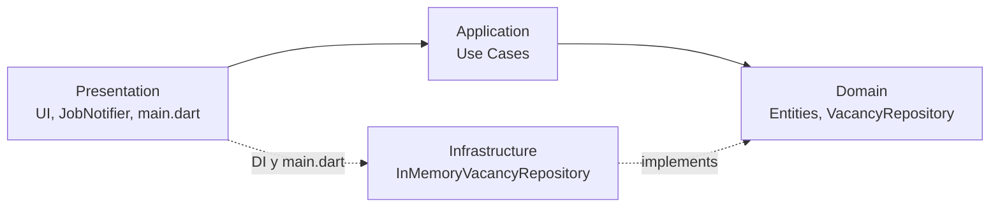

# Job Search

Застосунок для пошуку вакансій. Архітектура: Clean Architecture + Provider.

## Архітектура



Правило залежностей: стрілки спрямовані до Domain. Domain не імпортує жодного іншого шару.

| Шар | Відповідальність | Каталог |
|---|---|---|
| Domain | Сутності, бізнес-правила, інтерфейси | `lib/domain` |
| Application | Use cases | `lib/application` |
| Infrastructure | Реалізації репозиторіїв, конфіг | `lib/infrastructure` |
| Presentation | UI, Provider, Composition Root | `lib/presentation`, `lib/main.dart` |

## Гілки
`main` стабільний код, `develop` інтеграційна, `feature/*` окремі задачі.

## Збірка і запуск
```bash
git clone https://github.com/<user>/job-search-flutter.git
cd job-search-flutter
flutter pub get
flutter run
```
Вимоги: Flutter 3.x, Dart 3.x.